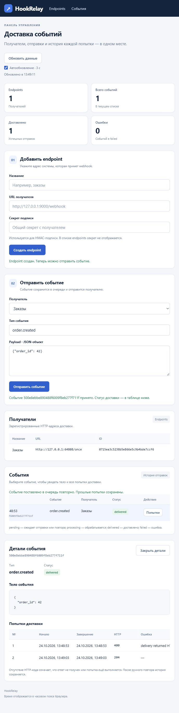

# Панель HookRelay

Панель доступна на `/` того же HTTP-сервера, что и REST API. Она показывает endpoints, события и историю попыток, позволяет добавить получателя, отправить событие и повторить неудачную доставку.

## Запуск

Поднимите PostgreSQL, примените миграции и задайте DATABASE_URL согласно [README](../README.md), затем запустите сервис:

```powershell
go run ./cmd/hookrelay
```

Откройте `http://localhost:8080/`. При другом HTTP_PORT измените порт страницы. Файлы встроены через Go embed; отдельный web-сервер и установка JavaScript-зависимостей не нужны. В браузере должен быть включён JavaScript. При его отсутствии формы недоступны.

## Первое событие

В отдельном терминале запустите проверяющего получателя:

```powershell
$env:WEBHOOK_SECRET = "dev-secret"
go run ./examples/receiver
```

В форме «Добавить endpoint» укажите название «Заказы», URL `http://127.0.0.1:9000/webhook` и секрет `dev-secret`. После успешного создания форма очищается, а новый endpoint выбирается в форме отправки. Код панели не записывает секрет в localStorage или sessionStorage; список API не возвращает secret.

В форме события оставьте тип `order.created` и payload `{"order_id": 42}`, затем отправьте. Сообщение о принятии означает сохранение в очереди. Результат появляется в таблице: при верной подписи и ответе `204` статус становится `delivered`.

Повреждённый JSON или значение, отличное от объекта, не отправляются в API. Все серверные правила валидации также продолжают работать; ошибка API отображается рядом с формой.

## Таблицы и обновление

Получатели показываются с названием, URL и ID. Таблица событий содержит время, ID, тип, получателя и статус. Новые события расположены сверху. Время отображается в часовом поясе браузера.

Сводка вычисляется из загруженных списков: количество endpoints, событий, delivered и failed. `pending` может означать ожидание времени повтора, а `processing` — работу воркера.

Автообновление запрашивает данные каждые три секунды на видимой вкладке. Его можно отключить и нажимать «Обновить данные». Один полный опрос выполняется за раз. Формы сохраняют введённые данные при обновлении таблиц. После записи панель дожидается старого опроса и получает свежий список.

При сбое обновления показанные строки остаются, а сверху появляется ошибка. Каждый запрос ограничен десятью секундами. После сетевого сбоя проверьте таблицу перед повторной отправкой: UI не добавляет идемпотентность API.

## Детали и повтор

«Попытки» открывает тело события и историю по номеру. Показываются начало, завершение, HTTP-код и ошибка. До первой отправки история пуста; незавершённая попытка отмечается «В работе». Отсутствующий HTTP-код отображается как тире.

Открытая история тоже обновляется. При переключении события запоздавший ответ старого запроса не заменяет выбранные данные.

«Повторить» появляется только у `failed`. Кнопка вызывает POST retry и начинает новый цикл из максимум четырёх попыток. ID и история сохраняются. При конфликте статуса API возвращает `409`; панель показывает ошибку и обновляет список.

Для проверки ошибки подписи запустите получателя с отличающимся WEBHOOK_SECRET. Он ответит `401`, событие станет `failed`. Затем задайте совпадающий секрет у получателя, перезапустите его и нажмите «Повторить»: в истории останутся неудачная и успешная попытки.

## Файлы и маршруты

| Файл | Назначение |
| --- | --- |
| internal/dashboard/handler.go | Встраивание файлов и регистрация GET-маршрутов |
| assets/index.html | Формы, таблицы и область деталей |
| assets/app.css | Оформление и прокрутка таблиц в узком окне |
| assets/app.js | Fetch, проверки форм, обновление и безопасный вывод |
| internal/orchestrator/orchestrator.go | Подключение панели к общему ServeMux |

Маршруты заданы явно: GET `/`, GET `/assets/app.css`, GET `/assets/app.js`. Неизвестные URL получают `404`. REST API, `/health`, SQL-схема и правила доставки не меняются.

Панель использует GET/POST endpoints, GET/POST events, GET event, GET attempts и POST retry. Прямых запросов к PostgreSQL в JavaScript нет.

## Ограничения

В сервисе нет аутентификации. Панель и API предназначены для доверенной среды; не открывайте HTTP-сервер напрямую в публичную сеть. Списки загружаются целиком, без пагинации. Удаление endpoint доступно через REST API.

Пользовательские значения выводятся через textContent. Скрипты и стили загружаются с того же сервера, страница устанавливает Content-Security-Policy.

## Проверки

```powershell
go test ./...
$env:TEST_DATABASE_URL = $env:DATABASE_URL
go test -count=1 -race ./...
go vet ./...
go build ./...
```

HTTP-тесты проверяют страницу, типы содержимого, HEAD, неизвестные маршруты и совместную работу с API. В браузере с временной схемой PostgreSQL проверены endpoint, событие, failed/400, ручной повтор и delivered/204 с сохранением истории, неверный JSON, ошибка API и вывод HTML-подобного имени текстом.


