# Архитектурные решения

```mermaid
flowchart TD
    client[Клиент или веб-панель] --> api[HTTP API - валидация JSON]
    api --> db[(PostgreSQL - события и история)]
    db --> workers[Два воркера - захват и аренда]
    workers --> sender[HTTP POST - HMAC и timeout]
    sender --> receiver[Получатель]
    sender --> db
    api --> logs[JSON-логи с request ID]
    workers --> logs
    metrics[Метрики приложения] --> prometheus[Prometheus]
    db --> metrics
```

| Решение | Причина и следствие |
| --- | --- |
| Один Go-сервис | HTTP API, панель и воркеры запускаются одним процессом; обмен между ними проходит через репозиторий |
| net/http | Маршрутизация, context и httptest из стандартной библиотеки достаточны для текущего API |
| PostgreSQL вместо отдельного брокера | Сохранение события одновременно ставит его в очередь, а транзакции связывают историю и результат |
| SQL и pgx без ORM | Запросы, блокировки и обработка ошибок явно видны в коде |
| FOR UPDATE SKIP LOCKED | Конкурентные воркеры пропускают занятые строки, не ожидая длительной обработки чужого задания |
| Аренда и её версия | Авария не оставляет событие навсегда в processing, а запоздалый воркер не перезаписывает нового владельца |
| HTTP вне транзакции | Медленный получатель не удерживает блокировку строки и SQL-соединение во время запроса |
| Фиксированные повторы | Сеть, timeout, 408, 429 и 5xx получают три повтора; расписание хранится в БД, Retry-After его не изменяет |
| HMAC по отправляемым байтам | Получатель проверяет целостность тела и общий секрет; изменение форматирования JSON после подписи нарушит проверку |
| HTML, CSS и JS через embed | Один бинарник содержит интерфейс, отдельный frontend-сервер не нужен |
| Метрики отдельно от БД | Счётчики процесса удобны для наблюдения, а текущее состояние очереди читается из сохранённых данных |

## Гарантии и границы

Событие считается принятым после сохранения в PostgreSQL. 201 не означает успешную отправку. Временные ошибки возвращают событие в pending до next_attempt_at; после четырёх попыток за цикл оно становится failed. Захват перед аварией тоже расходует попытку. Ручной повтор запускает новый цикл с прежним ID.

Получатель и наша БД не участвуют в общей транзакции. Получатель может обработать POST, после чего процесс потеряет ответ или не сохранит результат. При восстановлении запрос повторится. Получателю нужна собственная дедупликация для защиты бизнес-операций; гарантии exactly-once нет. Конечное число попыток также не гарантирует доставку постоянно недоступному получателю.

HMAC не шифрует запрос и не защищает от воспроизведения. Подписано тело, но не ID события и не время; секрет хранится в БД открытым текстом. Доверенный доступ к API и HTTP-получателям является условием этой конфигурации.

Списки не имеют пагинации. Опрос очереди каждые 250 мс создаёт обращения к PostgreSQL даже без заданий. Число воркеров фиксировано в сборке зависимостей; это небольшой сервис, а не система с неограниченным масштабированием.

## Как подтверждаются решения

Два пула одновременно забирают задания в интеграционных тестах. Отдельный процесс аварийно завершается во время POST; другой воркер восстанавливает событие. Ещё один сценарий закрывает соединения воркера после приёма получателем и проверяет повтор с тем же ID. Атомарность истории проверяется отказом записи статуса внутри транзакции. Полная матрица находится в [тестировании](testing.md).
